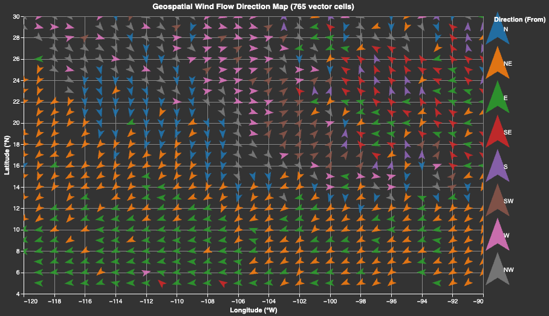

# Eddy Carbon Phase 1

## Work-in-progress

Building tools to analyze data from ASVs (Autonomous Surface Vehicles) together with satellite data to compute
Carbon Dioxide Removal Rate (CDDR) using the Atmospheric CO₂ Perimeter Flux (ACPF)
method described in:

* [Measuring large-scale mCDR using a novel Atmospheric CO₂ Perimeter Flux (ACPF) method](https://www.frontiersin.org/journals/climate/articles/10.3389/fclim.2026.1941538/full#fig1)  
  
* [Localized ocean fertilization is not OIF....It’s vastly better](https://climaterestoration.substack.com/p/localized-ocean-fertilization-is) -- some of the evidence for the hypothesis that fertilizing downwelling eddies can remove Gt levels of CO₂
* [How Safe is Ocean Fertilization?](https://climaterestoration.substack.com/p/how-safe-is-ocean-fertilization)

## Background

* [OSHEN C-Star ASVs](https://www.oshendata.com/)  
  
  
* [NASA Worldview](https://worldview.earthdata.nasa.gov/?v=-220.394549586033,-196.57913863316554,99.43043196175228,200.2567099899175&z=1&l=Reference_Labels_15m(hidden),Admin_Boundaries(hidden),DoS_International_Boundaries(hidden),Coastlines_15m(hidden),TOPEX-Poseidon_JASON_Sea_Surface_Height_Anomalies_US_West_Coast_GAFECC(hidden),TOPEX-Poseidon_JASON_Sea_Surface_Height_Anomalies_Reconstructed(hidden),TOPEX-Poseidon_JASON_Sea_Surface_Height_Anomalies_GDR_Cycles(hidden),JPL_MEaSUREs_L4_Sea_Surface_Height_Anomalies,S3B_OLCI_Chlorophyll_a(hidden),VIIRS_NOAA20_Chlorophyll_a(hidden),SEAWIFS_ORBVIEW-2_GAC_Chlorophyll_a,OCO-3_Carbon_Dioxide_Global_Mean_Difference,OCO-2_Carbon_Dioxide_Global_Mean_Difference(hidden),VIIRS_NOAA21_CorrectedReflectance_TrueColor(hidden),VIIRS_NOAA20_CorrectedReflectance_TrueColor(hidden),VIIRS_SNPP_CorrectedReflectance_TrueColor(hidden),MODIS_Aqua_CorrectedReflectance_TrueColor(hidden)&lg=true&t=2018-08-15-T19%3A35%3A28Z) showing Surface Height Anomalies
* [NullSchool Earth](https://earth.nullschool.net/#current/ocean/surface/currents/orthographic=-111.04,18.08,1697) wind, weather, and ocean conditions
* [CDRR](https://github.com/F4CR/f4cr-cdrr/tree/main)
* [Web-based views of co2 satellite data](https://github.com/F4CR/visualization)

## Initial Components

* Core implementation of the ACPF pipeline. See [ACPF math](doc/acpf_math.md) and [ACPF implementation plan](doc/acpf_implementation_plan.md).
* Marimo notebooks to visualize wind flow and ACPF analysis.

## Instructions

* Run `uv sync` in the project directory to create or update a Python virtual environment in the `.venv` folder and
  install/update all the library and tool dependencies listed in `pyproject.toml`.  
  (`uv sync --no-dev` for a production-only environment without dev dependencies.)  
  Launching PyCharm should notice the virtual environment and offer to use it. If PyCharm is already running, click the Python Interpreter selector in the bottom-right status bar. Built-in PyCharm terminal windows will automatically activate the virtual environment.
* Run all the unit tests: `uv run pytest`, or `uv run pytest -v` with verbose output.
* Run the `ty` type checker: `uv run ty check`, or  `uv run ty check src` to check just the `src/` directory.
* Run the `ruff` lint checker: `uv run ruff check .`, or `uv run ruff check --fix .` to auto-fix safe issues,
  `uv run ruff format --check .` to check formatting without modifying files, or `uv run ruff format .` to
  check and fix formatting.
* Run `uv run marimo check notebooks` to check the notebooks.
* Marimo notebooks can run in PyCharm, VS Code, and Antigravity IDE; best done with the Marimo plugin.

## Components TODO

* More test cases.
* Handle the case where there are only two ASVs (or effectively only two when the polygon degenerates to a sliver). Extrapolate a diamond with the ASVs on the diagonal? Extrapolate a wide chord with the ASVs on two sides? How wide? How much to multiply the Error bar in this case?
* Compare interpolation methods.
* Compare data from 2 sensors per buoy to look for sensor measurement problems. Experiment with how to handle discrepancies.
* Design visualizations/animations to make it clear how this method measures CDR (CO₂ removal rate), how well the paired CO2 sensors track either other and nearby sensors, and more. Also how CDR responds to changing conditions like shifting winds, .
* Discard or interpolate across problematic time intervals like a nearby passing diesel ship or rapid wind direction change.
* Simulate sensor data for testing the visualization and the computation, including handling bad sensor values and temporary situations.
* Data of various types from various satellites become available with different delay times. Some sources provide less accurate "near real time" data within days, then provide more accurate data after more days or weeks.
* Filter measurement noise.
* Combine multiple data sources for wind, barometric pressure, and air temperature data.
* Estimate the error bars.
* Test the case of a passing diesel-ship which spikes the CO₂ values.
* Keep a list of small effects to consider later (also tracked in `doc/acpf_math.md` Section 7):
  * **Local ENU tangent-plane vs. ellipsoidal geodesic geometry**: At ~200 km eddy scale, flat WGS 84 ENU horizontal chord-vs-arc distortion is < 0.02% (~8 m) and fractional area error scales as `(L / 2R)²`, negligible relative to wind and MBLH uncertainties. If deployments ever approach ~1000 km scale, consider switching to Karney ellipsoidal geodesic lengths/areas.
  * **ASV drift velocity frame & moving-boundary Reynolds correction**: Computing hourly ASV drift in a shared midpoint ENU frame avoids origin-shift drift when the hull centroid moves and provides `(u, v)` components for future `(w - w_asv) · n` moving-boundary corrections; for scalar speed alone, the 3D ECEF chord norm `‖X_k - X_{k-1}‖ / Δt` agrees to `< 1e-6` over hourly ASV displacements.

## Questions

* Do more to interpolate between data samples over time, sensor positions, and satellite data locations (e.g. MBLH measurements)?
* How to generate simulated data for testing the computation and visualizations?
* Plan to test some ASVs near land for a while to find out how much their CO₂ sensors and wind sensors track each other; how stable the wind data is when the ASV is bobbing, tilting, and turning; and tune failure and discrepancy thresholds/metrics?
* Test the sensor outputs when an ASV gets wet enough to soak the CO₂ sensors? What are the signatures of CO₂, wind, and GPS data anomalies in this situation? How long does it take all the sensors to recover?
* Will ASVs aggregate data like wind readings over a sampling interval and send more details than the average, e.g. a noise metric like STD or range? Or send a sequence of wind readings over the interval?
* Will an ASV send data successfully during a storm, while on its side, or while upside down? Will it buffer data until connectivity is restored?
