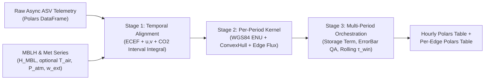

<!--suppress ALL -->
# Atmospheric $\text{CO}_2$ Perimeter Flux (ACPF) Mathematical Specification

This document is the persistent mathematical reference for the EddyP1 Atmospheric $\text{CO}_2$ Perimeter Flux (ACPF) computation. All symbols are globally unique across sections (zero symbol collisions). Each implementation module mirrors the relevant equations and glossary entries inline next to its algorithm stage.

Reference methodology: *Measuring large-scale mCDR using a novel Atmospheric $\text{CO}_2$ Perimeter Flux (ACPF) method*, Frontiers in Climate (2026), DOI `10.3389/fclim.2026.1941538`.

---

## 1. Pipeline Overview

- **Stage 1 (`resample.py`)**: Aligns asynchronous ASV telemetry onto a uniform UTC time grid with period step $\Delta t$ (default $1\text{ hr}$) using time-weighted interval integration of a pluggable per-ASV interpolant (`InterpolationMethod`), computing sailboat wind constancy and ASV drift diagnostics.
- **Stage 2 (`flux.py` + `geodesy.py`)**: Projects each period's valid ASVs to a local WGS 84 East-North tangent plane, constructs the CCW `scipy.spatial.ConvexHull` anchored at the alphabetically smallest hull `asv_id`, reconciles dual $\text{CO}_2$ sensors, and integrates lateral $\text{CO}_2$ perimeter flux with hydrostatic column scaling.
- **Stage 3 (`pipeline.py`)**: Combines per-period results across time to evaluate inter-period wind and $H_{\text{MBL}}$ stability, append the Eulerian column storage term $\Phi_{\text{stor}}$ and storage-adjusted CDRR $\Phi_{\text{net}}$, assign the ordered `ErrorBar` classification, and support multi-period window aggregation over $\tau_{\text{win}}$.

---

## 2. Symbol Glossary & Constants

### 2.1 Time, Indexing, and Counts

| Symbol | Code Identifier | Units | Definition |
| :--- | :--- | :--- | :--- |
| $t$ | `t` | $\text{s}$ | Continuous UTC time (epoch seconds as `float64`). |
| $t_k$ | `period_start` | $\text{s}$ | Start timestamp of discrete period $k$; period $k$ covers $[t_k,\, t_k + \Delta t)$. |
| $\Delta t$ | `time_interval` | $\text{s}$ | Duration of one aggregation step (named constant `DEFAULT_TIME_INTERVAL = timedelta(hours=1)`, i.e. $3600\text{ s}$). |
| $\Delta t_{\text{gap,max}}$ | `max_interp_gap` | $\text{s}$ | Maximum silence gap between consecutive raw observations of an ASV that may be bridged by interpolation (default $3\,\Delta t$). |
| $\tau_{\text{win}}$ | `window_duration` | $\text{s}$ (or $\text{hr}$ / $\text{d}$) | Multi-period aggregation or rolling-average window length $(\tau_{\text{win}} = K_{\text{win}}\,\Delta t \ge \Delta t)$. |
| $K_{\text{win}}$ | `window_periods` | count | Integer number of $\Delta t$ aggregation steps in the multi-period window $\tau_{\text{win}}$. |
| $\mathcal{K}_{\text{valid}}$ | `valid_period_indices` | set | Set of period indices $k$ within $\tau_{\text{win}}$ whose `ErrorBar` meets the selected severity filter. |
| $i$ | `asv_idx` | — | Index of a valid ASV in period $k$, $i \in \{0, \dots, N_{\text{tot}} - 1\}$. |
| $N_{\text{tot}}$ | `n_asvs_total` | count | Number of valid ASVs with usable position, wind, and $\text{CO}_2$ in period $k$. |
| $N_{\text{hull}}$ | `n_asvs_hull` | count | Number of ASVs forming the outer CCW convex-hull boundary $(N_{\text{hull}} \le N_{\text{tot}})$. |
| $e$ | `edge_idx` | — | Index of a CCW convex-hull edge from vertex $e$ to $(e + 1) \bmod N_{\text{hull}}$, where vertex $0$ has the alphabetically smallest `asv_id` on the hull. |

### 2.2 Geodesy & Polygon Geometry

| Symbol | Code Identifier | Units | Value / Definition |
| :--- | :--- | :--- | :--- |
| $a_{\text{wgs}}$ | `WGS84_SEMI_MAJOR_M` | $\text{m}$ | $6{,}378{,}137.0\text{ m}$ (exact WGS 84 equatorial radius). |
| $f_{\text{wgs}}$ | `WGS84_FLATTENING` | $1$ | $1 / 298.257223563$ (exact WGS 84 flattening). |
| $e_{\text{wgs}}^2$ | `WGS84_E2` | $1$ | $2 f_{\text{wgs}} - f_{\text{wgs}}^2 \approx 0.00669437999014132$ (first eccentricity squared). |
| $\phi,\, \lambda$ | `latitude`, `longitude` | $\text{rad}$ (inputs in $\text{deg}$) | Geodetic latitude (North positive) and longitude (East positive). |
| $\phi_0,\, \lambda_0$ | `origin_lat`, `origin_lon` | $\text{rad}$ | Reference origin of the local ENU tangent plane, computed from the normalized 3D ECEF centroid. |
| $\nu(\phi)$ | `prime_vertical_radius` | $\text{m}$ | Prime vertical radius of curvature $a_{\text{wgs}} / \sqrt{1 - e_{\text{wgs}}^2 \sin^2\phi}$. |
| $\mathbf{X}_i = (X_i, Y_i, Z_i)^\top$ | `ecef_xyz` | $\text{m}$ | 3D Earth-Centered Earth-Fixed (ECEF) position of ASV $i$ on the WGS 84 sea-level surface (​$h_{\text{ellip}} = 0$). |
| $\mathbf{R}_{\text{enu}}(\phi_0, \lambda_0)$ | `enu_rotation` | $1$ | $3 \times 3$ orthonormal rotation matrix from ECEF displacements to local East-North-Up (ENU). |
| $\mathbf{p}_i = (x_i, y_i)^\top$ | `xy_m` | $\text{m}$ | 2D local metric coordinates of ASV $i$ (​$x$ = East, $y$ = North). |
| $\mathbf{P}$ | `xy_m_matrix` | $\text{m}$ | $N_{\text{tot}} \times 2$ matrix whose rows are the local EN coordinate vectors $\mathbf{p}_i^\top$ for all valid ASVs in period $k$. |
| $\bar{\mathbf{p}}$ | `xy_centroid_m` | $\text{m}$ | 2D arithmetic centroid $\frac{1}{N_{\text{tot}}}\sum_i \mathbf{p}_i$ of the projected local EN coordinates. |
| $\tilde{\mathbf{P}}$ | `xy_centered_m` | $\text{m}$ | Mean-centered $N_{\text{tot}} \times 2$ coordinate matrix $\mathbf{P} - \mathbf{1}\bar{\mathbf{p}}^\top$ used for the collinearity rank test. |
| $L_e$ | `edge_length_m` | $\text{m}$ | Length of CCW hull edge $e$: $\lVert\mathbf{p}_{(e+1)\bmod N_{\text{hull}}} - \mathbf{p}_e\rVert_2$. |
| $L_{\text{perim}}$ | `hull_perimeter_m` | $\text{m}$ | Total perimeter length $\sum_e L_e$ (`hull.area` in 2D `ConvexHull`). |
| $A_{\text{hull}}$ | `hull_area_m2` | $\text{m}^2$ | Enclosed 2D polygon area (`hull.volume` in 2D `ConvexHull`). |
| $Q_{\text{iso}}$ | `hull_compactness` | $1$ | Isoperimetric quotient (Polsby-Popper score) $4\pi A_{\text{hull}} / L_{\text{perim}}^2 \in (0, 1]$. |
| $\hat{\mathbf{n}}_e = (n_{e,x}, n_{e,y})^\top$ | `edge_normal_xy` | $1$ | Outward-pointing unit normal to CCW edge $e$. |

### 2.3 Wind, Motion, and $\text{CO}_2$ Measurements

| Symbol | Code Identifier | Units | Definition |
| :--- | :--- | :--- | :--- |
| $\mathbf{w}_i = (u_i, v_i)^\top$ | `(u_wind, v_wind)` | $\text{m}\,\text{s}^{-1}$ | Period-averaged horizontal wind velocity vector (flow *toward* direction: $u$ Eastward, $v$ Northward) at ASV $i$. |
| $\bar{\mathbf{w}}_k = (\bar{u}_k, \bar{v}_k)^\top$ | `(mean_wind_u, mean_wind_v)` | $\text{m}\,\text{s}^{-1}$ | Spatial vector mean wind across all $N_{\text{tot}}$ valid ASVs in period $k$. |
| $\mathbf{w}_{\text{ext},k}$ | `(u_wind_ext, v_wind_ext)` | $\text{m}\,\text{s}^{-1}$ | Optional external (e.g., satellite/reanalysis) uniform horizontal wind vector for period $k$. |
| $\mathbf{w}_e$ | `edge_wind_xy` | $\text{m}\,\text{s}^{-1}$ | Effective horizontal wind vector used on hull edge $e$ (determined by `WindMode`). |
| $\mathbf{w}_{\text{asv},i}$ | `(asv_drift_u, asv_drift_v)` | $\text{m}\,\text{s}^{-1}$ | Horizontal ground/drift velocity of ASV $i$ between consecutive periods (moving-boundary diagnostic). |
| $s_i$ | `wind_speed` | $\text{m}\,\text{s}^{-1}$ | Scalar wind speed $\lVert\mathbf{w}_i\rVert_2$ at ASV $i$. |
| $s_{\text{poly},k}$ | `mean_wind_speed_m_s` | $\text{m}\,\text{s}^{-1}$ | Magnitude of the polygon-mean wind vector $\lVert\bar{\mathbf{w}}_k\rVert_2$ in period $k$. |
| $\theta_{w,k}$ | `wind_flow_rad` | $\text{rad}$ | Wind flow heading angle $\mathrm{atan2}(\bar{v}_k, \bar{u}_k) \in (-\pi, \pi]$ (CCW from East). |
| $r_{\text{const},i}$ | `wind_constancy` | $1$ | Intra-period wind vector constancy $\lVert\bar{\mathbf{w}}_{i,k}\rVert_2 / \overline{\lVert\mathbf{w}_i\rVert}_{k} \in [0, 1]$ (1 = perfectly steady direction; 0 = complete reversal/turning cancellation). |
| $D_w$ | `wind_divergence_m2_s` | $\text{m}^2\,\text{s}^{-1}$ | Raw discrete horizontal wind divergence around the hull using local per-ASV edge winds. |
| $c_{i,1},\, c_{i,2}$ | `co2_1`, `co2_2` | $\text{ppm}$ | Period-averaged dry-air $\text{CO}_2$ mole fractions (​$\mu\text{mol}\,\text{mol}^{-1}$) from sensors 1 and 2 on ASV $i$. |
| $c_i$ | `co2_ppm` | $\text{ppm}$ | Reconciled dry-air $\text{CO}_2$ mole fraction for ASV $i$. |
| $\delta c_i$ | `co2_sensor_diff_ppm` | $\text{ppm}$ | Absolute dual-sensor discrepancy $\lvert c_{i,1} - c_{i,2}\rvert$ on ASV $i$. |
| $\bar{c}_e$ | `edge_co2_ppm` | $\text{ppm}$ | Mean dry-air $\text{CO}_2$ mole fraction along hull edge $e$. |
| $c_{\text{ref}}$ | `co2_ref_ppm` | $\text{ppm}$ | Reference background $\text{CO}_2$ mole fraction subtracted before edge flux multiplication. |
| $\bar{c}_{\text{box},k}$ | `box_mean_co2_ppm` | $\text{ppm}$ | Spatial mean $\text{CO}_2$ mole fraction across all $N_{\text{tot}}$ valid ASVs in period $k$. |

### 2.4 Atmospheric Thermodynamics & Flux Outputs

| Symbol | Code Identifier | Units | Value / Definition |
| :--- | :--- | :--- | :--- |
| $R_{\text{gas}}$ | `UNIVERSAL_GAS_CONSTANT` | $\text{J}\,\text{mol}^{-1}\,\text{K}^{-1}$ | $8.314462618$ (CODATA 2018/2022 exact SI value). |
| $M_{\text{CO}_2}$ | `MOLAR_MASS_CO2_KG` | $\text{kg}\,\text{mol}^{-1}$ | $0.0440095$ (IUPAC/NIST molar mass of $\text{CO}_2$). |
| $M_{\text{air}}$ | `MOLAR_MASS_DRY_AIR_KG` | $\text{kg}\,\text{mol}^{-1}$ | $0.0289644$ (U.S. Standard Atmosphere 1976 dry air). |
| $R_d$ | `DRY_AIR_GAS_CONSTANT` | $\text{J}\,\text{kg}^{-1}\,\text{K}^{-1}$ | $R_{\text{gas}} / M_{\text{air}} \approx 287.05796$. |
| $g_0$ | `STANDARD_GRAVITY` | $\text{m}\,\text{s}^{-2}$ | $9.80665$ (exact standard gravity). |
| $H_{\text{MBL}}$ | `mblh_m` | $\text{m}$ | Marine Boundary Layer Height for period $k$ (required positive input). |
| $T_{\text{air}}$ | `t_air_k` | $\text{K}$ | Near-surface air temperature (optional; default $293.15\text{ K} = 20^\circ\text{C}$). |
| $P_{\text{atm}}$ | `p_atm_pa` | $\text{Pa}$ | Surface barometric pressure (optional; default $101{,}325.0\text{ Pa}$). |
| $H_{\text{scale}}$ | `scale_height_m` | $\text{m}$ | Hydrostatic dry-air scale height $R_d T_{\text{air}} / g_0$. |
| $H_{\text{eff}}$ | `effective_mblh_m` | $\text{m}$ | Density-weighted effective MBL column height. |
| $\kappa_{\text{CO}_2}$ | `co2_mass_per_ppm_kg_m3` | $\text{kg}\,\text{m}^{-3}\,\text{ppm}^{-1}$ | Surface mass concentration of $\text{CO}_2$ per $1\text{ ppm}$ dry-air mole fraction. |
| $\gamma_{\text{unit}}$ | `KG_PER_S_TO_T_PER_HR` | $(\text{tCO}_2\,\text{hr}^{-1})/(\text{kg}\,\text{s}^{-1})$ | $3600 / 1000 = 3.6$ (exact). |
| $\Phi_{\text{edge},e}$ | `edge_outward_flux_tco2_hr` | $\text{tCO}_2\,\text{hr}^{-1}$ | Outward lateral $\text{CO}_2$ mass flux across edge $e$ (positive = leaving polygon). |
| $\Phi_{\text{lat}}$ | `lateral_cdrr_tco2_hr` | $\text{tCO}_2\,\text{hr}^{-1}$ | Net Carbon Dioxide Removal Rate estimated from horizontal (lateral) perimeter flux alone, before adding column storage (positive = net ocean uptake/removal). |
| $\Phi_{\text{stor}}$ | `storage_flux_tco2_hr` | $\text{tCO}_2\,\text{hr}^{-1}$ | Eulerian column storage contribution to surface CDRR. |
| $\Phi_{\text{net}}$ | `storage_adjusted_cdrr_tco2_hr` | $\text{tCO}_2\,\text{hr}^{-1}$ | Storage-adjusted surface CDRR (​$\Phi_{\text{lat}} + \Phi_{\text{stor}}$). |
| $\psi_{\text{lat}},\, \psi_{\text{net}}$ | `lateral_cdrr_tco2_km2_hr`, `storage_adjusted_cdrr_tco2_km2_hr` | $\text{tCO}_2\,\text{km}^{-2}\,\text{hr}^{-1}$ | Areal removal flux densities (removal rate per unit enclosed ocean surface area, i.e., $\Phi$ divided by $A_{\text{hull}}$ in $\text{km}^2$). |

### 2.5 Configuration & Quality-Assurance Threshold Constants (`ACPFConfig`)

| Symbol | Code Identifier | Units | Default / Definition |
| :--- | :--- | :--- | :--- |
| $\epsilon_w$ | `MIN_WIND_SPEED_EPS` | $\text{m}\,\text{s}^{-1}$ | $10^{-9}\text{ m}\,\text{s}^{-1}$ zero-wind guard for constancy denominator. |
| $A_{\min}$ | `min_hull_area_m2` | $\text{m}^2$ | $10^{6}\text{ m}^2$ ($1\text{ km}^2$) minimum enclosing hull area to reject degenerate hulls. |
| $Q_{\text{iso,min}}$ | `min_hull_compactness` | $1$ | $0.05$ minimum Polsby-Popper compactness to reject nearly collinear slivers. |
| $\delta_{\text{CO}_2,\max}$ | `max_co2_sensor_diff_ppm` | $\text{ppm}$ | $2.0\text{ ppm}$ dual-sensor discrepancy warning threshold. |
| $r_{\text{const,min}}$ | `min_wind_constancy` | $1$ | $0.80$ minimum intra-period wind vector constancy before flagging unstable wind. |
| $\Delta \theta_{w,\max}$ | `max_wind_dir_change_deg` | $\text{deg}$ (math: $\text{rad}$) | $30.0^\circ$ maximum inter-period wind direction shift before flagging unstable wind. |
| $\eta_{w,\max}$ | `max_wind_speed_rel_change` | $1$ | $0.35$ (​$35\%$) maximum relative inter-period wind speed change. |
| $\eta_{H,\max}$ | `max_mblh_rel_change` | $1$ | $0.25$ (​$25\%$) maximum relative inter-period $H_{\text{MBL}}$ change. |

---

## 3. Geodetic Coordinate Transformations (`geodesy.py`)

### 3.1 Geodetic $(\phi, \lambda)$ to 3D WGS 84 ECEF

For sea-surface ASVs (​$h_{\text{ellip}} = 0$), geodetic latitude $\phi$ and longitude $\lambda$ map to 3D ECEF coordinates $\mathbf{X} = (X, Y, Z)^\top$ via:

$$\nu(\phi) = \frac{a_{\text{wgs}}}{\sqrt{1 - e_{\text{wgs}}^2 \sin^2\phi}}$$

$$X = \nu(\phi)\cos\phi\cos\lambda, \qquad Y = \nu(\phi)\cos\phi\sin\lambda, \qquad Z = \nu(\phi)(1 - e_{\text{wgs}}^2)\sin\phi$$

Interpolating ASV positions in 3D ECEF (Stage 1) and computing the centroid in 3D ECEF (Stage 2) avoids all $\pm 180^\circ$ International Date Line and polar discontinuities.

### 3.2 Inverse ECEF to Geodetic Origin $(\phi_0, \lambda_0)$

Given $N_{\text{tot}}$ ASV ECEF vectors $\{\mathbf{X}_i\}$, form the mean ECEF vector $\bar{\mathbf{X}} = \frac{1}{N_{\text{tot}}}\sum_i \mathbf{X}_i$ and convert it to reference geodetic coordinates $(\phi_0, \lambda_0)$ using Bowring's exact closed-form / iterative ellipsoidal projection (2 Newton-Raphson iterations from $\phi^{(0)} = \mathrm{atan2}(\bar{Z},\, (1 - e_{\text{wgs}}^2)\sqrt{\bar{X}^2 + \bar{Y}^2})$ converge to $< 10^{-15}\text{ rad}$), and project the origin onto the sea-level ellipsoid $\mathbf{X}_0 = \mathbf{X}(\phi_0, \lambda_0)$.

### 3.3 ECEF to Local East-North-Up (ENU) Tangent Plane

Each ASV displacement $\Delta \mathbf{X}_i = \mathbf{X}_i - \mathbf{X}_0$ is rotated into the local ENU frame:

$$\begin{bmatrix} x_i \\ y_i \\ z_{\text{enu},i} \end{bmatrix} = \mathbf{R}_{\text{enu}}(\phi_0, \lambda_0)\,\Delta \mathbf{X}_i = \begin{bmatrix} -\sin\lambda_0 & \cos\lambda_0 & 0 \\ -\sin\phi_0\cos\lambda_0 & -\sin\phi_0\sin\lambda_0 & \cos\phi_0 \\ \cos\phi_0\cos\lambda_0 & \cos\phi_0\sin\lambda_0 & \sin\phi_0 \end{bmatrix} \begin{bmatrix} X_i - X_0 \\ Y_i - Y_0 \\ Z_i - Z_0 \end{bmatrix}$$

We take the horizontal components $\mathbf{p}_i = (x_i, y_i)^\top$ in meters for 2D convex-hull geometry. Over a $200\text{ km}$ eddy radius, flat tangent-plane horizontal distortion is $< 0.02\%$ (well below wind and $H_{\text{MBL}}$ uncertainties).

---

## 4. Stage 1: Asynchronous Telemetry Alignment & Resampling (`resample.py`)

### 4.1 Pluggable Time-Weighted Interval Integral

ASVs transmit asynchronously and at irregular intervals. For each ASV $i$ and each scalar channel $q(t) \in \{X(t), Y(t), Z(t), u(t), v(t), c_1(t), c_2(t)\}$ sorted by strictly increasing timestamp $t$:

1. **Duplicate timestamps**: Any exact duplicate timestamps for the same ASV are averaged before fitting the interpolant.
2. **Pluggable interpolant $\hat{q}(t)$** selected by `InterpolationMethod`:
   - `LINEAR` (default): piecewise-linear spline via `scipy.interpolate.make_interp_spline(t_obs, q_obs, k=1)`.
   - `PCHIP`: shape-preserving monotonicity-guaranteed cubic Hermite spline via `scipy.interpolate.PchipInterpolator(t_obs, q_obs, extrapolate=False)` (strictly zero overshoot).
   - `AKIMA`: outlier-resistant $C^1$ local cubic spline via `scipy.interpolate.Akima1DInterpolator(t_obs, q_obs, extrapolate=False)` (requires $\ge 5$ samples; falls back to `PCHIP` or `LINEAR` when fewer samples exist).
3. **Time-weighted period average** over period $k = [t_k,\, t_k + \Delta t)$:

$$\bar{q}_{i,k} = \frac{1}{\Delta t} \int_{t_k}^{t_k + \Delta t} \hat{q}_i(t)\,dt$$

This unified integral simultaneously:
- Time-weight-averages dense sub-hourly observations (canceling high-frequency sailboat turning/bobbing oscillations without clustered-sample bias).
- Smoothly bridges asynchronous or slightly sparser observations via the exact same `.integrate(t_k, t_k + Δt)` interface.
- Reproduces constants $q(t) = a$ and linear ramps $q(t) = a + b t$ exactly (yielding $a + b(t_k + \Delta t / 2)$) for both `LINEAR` and `PCHIP`.

### 4.2 No-Extrapolation and Maximum Gap Guard

A period $[t_k,\, t_k + \Delta t)$ is valid for channel $q$ on ASV $i$ **if and only if**:
1. The period lies within the ASV's observed span: $t_{\text{obs},0} \le t_k$ and $t_k + \Delta t \le t_{\text{obs},\text{last}}$ (never extrapolate).
2. Every consecutive raw sample interval $[t_m, t_{m+1}]$ that overlaps $[t_k, t_k + \Delta t)$ satisfies $t_{m+1} - t_m \le \Delta t_{\text{gap,max}}$.

If a period fails either check for position or wind (or for *both* `co2_1` and `co2_2`), that ASV is omitted from period $k$ rather than fabricating data across a telemetry outage. (If only one of `co2_1` or `co2_2` passes, the ASV remains valid and triggers the dual-sensor discrepancy flag in Stage 2.)

### 4.3 Intra-Period Sailboat Wind Constancy & Drift Velocity Diagnostics

- **Intra-period wind vector constancy** (measuring sub-hourly sailboat turning/yaw noise and intra-hour wind shifts):
  For the raw wind speed channel $s_i(t) = \sqrt{u_i(t)^2 + v_i(t)^2}$, compute the time-weighted scalar speed mean $\bar{s}_{i,k} = \frac{1}{\Delta t}\int_{t_k}^{t_k + \Delta t} \hat{s}_i(t)\,dt$ and compare it to the magnitude of the period-averaged vector wind $\bar{\mathbf{w}}_{i,k} = (\bar{u}_{i,k}, \bar{v}_{i,k})^\top$:

$$r_{\text{const},i,k} = \begin{cases} \dfrac{\|\bar{\mathbf{w}}_{i,k}\|_2}{\bar{s}_{i,k}}, & \bar{s}_{i,k} > \epsilon_w \\ 1.0, & \bar{s}_{i,k} \le \epsilon_w \end{cases}$$

  where $r_{\text{const},i,k} \in [0, 1]$ (with $\epsilon_w = 10^{-9}\text{ m}\,\text{s}^{-1}$). Values significantly below $1$ indicate high-frequency turning oscillation or rapid wind-direction shifts within the hour.
- **ASV drift velocity** (for moving vs. station-keeping sailboats):
  Between adjacent periods $k-1$ and $k$ (separated by $\Delta t$), the local EN displacement $\Delta \mathbf{p}_{i,k} = \mathbf{p}_{i,k} - \mathbf{p}_{i,k-1}$ gives the ASV's horizontal velocity $\mathbf{w}_{\text{asv},i,k} = \Delta \mathbf{p}_{i,k} / \Delta t$, reported as a diagnostic (`max_asv_drift_speed_m_s`) to monitor whether moving-boundary Reynolds corrections $(\mathbf{w} - \mathbf{w}_{\text{asv}})$ become significant relative to wind speed.

### 4.4 MBLH & Meteorological Alignment

The meteorological table (`timestamp`, `mblh_m`, optional `t_air_k`, `p_atm_pa`, `u_wind_ext`, `v_wind_ext`) is aligned onto the same $[t_k,\, t_k + \Delta t)$ grid using the same interval-integral resampler (with gap guard), or matched directly when already provided on the $\Delta t$ grid.

---

## 5. Stage 2: Per-Period Convex-Hull Perimeter Flux (`flux.py`)

### 5.1 Dual-Sensor $\text{CO}_2$ Reconciliation

For each valid ASV $i$ in period $k$:

$$c_i = \begin{cases} \dfrac{c_{i,1} + c_{i,2}}{2}, & \text{both } c_{i,1}, c_{i,2} \text{ finite} \\ c_{i,1}, & c_{i,2} \text{ missing/NaN} \\ c_{i,2}, & c_{i,1} \text{ missing/NaN} \end{cases}$$

$$\delta c_i = \begin{cases} |c_{i,1} - c_{i,2}|, & \text{both finite} \\ +\infty \text{ (flagged as single-sensor)}, & \text{one sensor missing} \end{cases}$$

An ASV is flagged for sensor discrepancy if one sensor is missing or $\delta c_i > \delta_{\text{CO}_2,\text{max}}$. Flagged ASVs remain in the hull so geometry is preserved, while elevating the period's `ErrorBar` classification.

### 5.2 Convex Hull Construction, Canonical Ordering, and Degeneracy Checks

Given $N_{\text{tot}}$ valid ASVs projected to local EN coordinates $\{\mathbf{p}_i\}$:

1. **Count checks**:
   - If $N_{\text{tot}} < 2$ or $H_{\text{MBL}} \le 0$ or $H_{\text{MBL}}$ is NaN: return `NaN` flux with `ErrorBar.INSUFFICIENT_ASVS`.
   - If $N_{\text{tot}} = 2$: return `NaN` flux with `ErrorBar.TWO_ASV_EXTRAPOLATED` (​$N = 2$ extrapolation deferred).
2. **Degeneracy check** (for $N_{\text{tot}} \ge 3$):
   - Compute centered points $\tilde{\mathbf{P}} = \mathbf{P} - \bar{\mathbf{p}}$. If $\mathrm{rank}(\tilde{\mathbf{P}}) < 2$ or `scipy.spatial.ConvexHull(P)` raises `QhullError` (never use `"QJ"` random joggle), classify as `ErrorBar.TWO_ASV_EXTRAPOLATED` with `NaN` flux.
   - Extract `hull = ConvexHull(P)`:
     - $A_{\text{hull}} = \text{hull.volume}$ (​$\text{m}^2$)
     - $L_{\text{perim}} = \text{hull.area}$ (​$\text{m}$)
     - $Q_{\text{iso}} = \dfrac{4\pi A_{\text{hull}}}{L_{\text{perim}}^2}$
   - If $A_{\text{hull}} < A_{\min}$ or $Q_{\text{iso}} < Q_{\text{iso,min}}$, the array forms a degenerate sliver without an enclosing 2D perimeter; classify as `ErrorBar.TWO_ASV_EXTRAPOLATED` with `NaN` flux.
3. **Canonical CCW rotation**:
   - `hull.vertices` in 2D SciPy are guaranteed counterclockwise (CCW).
   - Find index $m$ in `hull.vertices` whose corresponding `asv_id` is **alphabetically smallest** (e.g., `"Oshen1"` before `"Oshen2"`), and cyclically shift `hull.vertices` so that vertex $m$ is at position $0$.
4. **Interior ASVs** (​$N_{\text{hull}} < N_{\text{tot}}$):
   - Only the $N_{\text{hull}}$ boundary vertices form edges for the line integral.
   - All $N_{\text{tot}}$ valid ASVs still contribute to $\bar{\mathbf{w}}_k$, $\bar{c}_{\text{box},k}$, and dual-sensor QA diagnostics.

### 5.3 Edge Lengths and Outward Unit Normals

For each CCW edge $e \in \{0, \dots, N_{\text{hull}} - 1\}$ from $\mathbf{p}_{e_0}$ to $\mathbf{p}_{e_1}$ (where $e_1 = (e + 1) \bmod N_{\text{hull}}$):

$$\Delta x_e = x_{e_1} - x_{e_0}, \qquad \Delta y_e = y_{e_1} - y_{e_0}, \qquad L_e = \sqrt{\Delta x_e^2 + \Delta y_e^2}$$

For a CCW polygon, rotating the tangent vector $(\Delta x_e, \Delta y_e)^\top$ by $-90^\circ$ (to the right) yields the **outward-pointing unit normal**:

$$\hat{\mathbf{n}}_e = \frac{1}{L_e}\begin{bmatrix} \Delta y_e \\ -\Delta x_e \end{bmatrix}$$

Geometric closure identity (exact to machine precision for any closed polygon):

$$\sum_{e=0}^{N_{\text{hull}}-1} L_e\,\hat{\mathbf{n}}_e = \mathbf{0}$$

### 5.4 Wind Mode, Background Subtraction, and Divergence Diagnostic

Let the local per-ASV edge wind be $\mathbf{w}_{e,\text{local}} = \frac{1}{2}(\mathbf{w}_{e_0} + \mathbf{w}_{e_1})$. The **raw discrete horizontal wind divergence diagnostic** is always computed (even in uniform wind mode) to detect individual sailboat anemometer tilt or heading biases:

$$D_w = \sum_{e=0}^{N_{\text{hull}}-1} (\mathbf{w}_{e,\text{local}} \cdot \hat{\mathbf{n}}_e)\, L_e \qquad [\text{m}^2\,\text{s}^{-1}]$$

The effective edge wind $\mathbf{w}_e$ used in the flux integral depends on `WindMode`:
- `UNIFORM_MEAN` (default): $\mathbf{w}_e = \bar{\mathbf{w}}_k = \frac{1}{N_{\text{tot}}}\sum_{i=0}^{N_{\text{tot}}-1} \mathbf{w}_i$. By the geometric closure identity, $\sum_e (\bar{\mathbf{w}}_k \cdot \hat{\mathbf{n}}_e) L_e = 0$ identically, completely eliminating anemometer divergence error on the ~420 ppm background.
- `EXTERNAL`: $\mathbf{w}_e = \mathbf{w}_{\text{ext},k}$ (e.g., satellite or reanalysis wind; also strictly zero divergence).
- `PER_ASV`: $\mathbf{w}_e = \mathbf{w}_{e,\text{local}}$ (retains spatial wind shear across the eddy; relies on $c_{\text{ref}}$ subtraction below to suppress the $c_{\text{ref}} D_w$ background-divergence error).

For every edge $e$, compute edge-mean $\text{CO}_2$ and subtract the hull-mean reference background $c_{\text{ref}}$:

$$\bar{c}_e = \frac{c_{e_0} + c_{e_1}}{2}, \qquad c_{\text{ref}} = \frac{1}{N_{\text{hull}}}\sum_{j=0}^{N_{\text{hull}}-1} c_{j}$$

Under uniform wind (​$\mathbf{w}_e = \bar{\mathbf{w}}_k$), subtracting $c_{\text{ref}}$ leaves the exact integral unchanged analytically while eliminating catastrophic floating-point cancellation on $\sim 420\text{ ppm}$ numbers. Under `PER_ASV` wind, subtracting $c_{\text{ref}}$ removes the spurious $c_{\text{ref}} D_w$ mass-imbalance term (implicitly assuming compensating vertical entrainment/subsidence carries concentration $c_{\text{ref}}$).

### 5.5 Hydrostatic Column Density Scaling & Flux Conversion

1. **Surface $\text{CO}_2$ mass concentration per $1\text{ ppm}$ dry-air mole fraction** (ideal gas law):

$$\kappa_{\text{CO}_2} = 10^{-6} \cdot \frac{P_{\text{atm}}\, M_{\text{CO}_2}}{R_{\text{gas}}\, T_{\text{air}}} \qquad [\text{kg}\,\text{m}^{-3}\,\text{ppm}^{-1}]$$

2. **Hydrostatic barometric effective column height** across $H_{\text{MBL}}$ (assuming a well-mixed dry-air mole fraction $c$ vertically through the MBL and hydrostatic exponential density decay with scale height $H_{\text{scale}}$):

$$H_{\text{scale}} = \frac{R_d\, T_{\text{air}}}{g_0}, \qquad H_{\text{eff}} = \int_0^{H_{\text{MBL}}} e^{-z / H_{\text{scale}}}\,dz = H_{\text{scale}}\left(1 - \exp\!\left(-\frac{H_{\text{MBL}}}{H_{\text{scale}}}\right)\right)$$

   *(At $T_{\text{air}} = 293.15\text{ K}$ and $H_{\text{MBL}} = 1000\text{ m}$, $H_{\text{scale}} \approx 8581\text{ m}$ and $H_{\text{eff}} \approx 943.9\text{ m}$, correcting the $\approx 5.6\%$ constant-density overestimate.)*

3. **Per-edge outward $\text{CO}_2$ mass flux** (​$\text{tCO}_2\,\text{hr}^{-1}$, positive = leaving polygon):

$$\Phi_{\text{edge},e} = \gamma_{\text{unit}} \cdot \kappa_{\text{CO}_2} \cdot H_{\text{eff}} \cdot (\bar{c}_e - c_{\text{ref}}) \cdot (\mathbf{w}_e \cdot \hat{\mathbf{n}}_e) \cdot L_e$$

4. **Net lateral Carbon Dioxide Removal Rate (CDRR)** (​$\text{tCO}_2\,\text{hr}^{-1}$, **positive = net ocean removal/uptake**)—the net removal rate estimated solely from horizontal (lateral) flow across the perimeter walls, before adding the Stage 3 column storage correction $\Phi_{\text{stor}}$:

$$\Phi_{\text{lat}} = -\sum_{e=0}^{N_{\text{hull}}-1} \Phi_{\text{edge},e}$$

5. **Areal removal flux density** (​$\text{tCO}_2\,\text{km}^{-2}\,\text{hr}^{-1}$)—the removal rate per unit of enclosed ocean surface area (normalizing $\Phi_{\text{lat}}$ by $A_{\text{hull}}$ in $\text{km}^2$ so removal intensity is comparable across different eddy sizes or drifting hull areas):

$$\psi_{\text{lat}} = \frac{\Phi_{\text{lat}}}{A_{\text{hull}} \times 10^{-6}}$$

---

## 6. Stage 3: Multi-Period Continuity, Storage Term & Quality Classification (`pipeline.py`)

### 6.1 Column Storage Term & Storage-Adjusted CDRR

Across a ~200 km eddy at 5–10 m/s wind, an air mass takes 6–13 hours to transit from the upwind to downwind perimeter. Ignoring top-of-MBL entrainment, integral mass conservation over effective volume $V_{\text{eff},k} = A_{\text{hull},k} H_{\text{eff},k}$ gives:

$$\Phi_{\text{net},k} = \Phi_{\text{lat},k} + \Phi_{\text{stor},k}$$

$$\Phi_{\text{stor},k} = -\gamma_{\text{unit}} \cdot \kappa_{\text{CO}_2,k} \cdot A_{\text{hull},k} \cdot H_{\text{eff},k} \cdot \left(\frac{\Delta \bar{c}_{\text{box}}}{\Delta t}\right)_k$$

where $\bar{c}_{\text{box},k} = \frac{1}{N_{\text{tot},k}}\sum_{i=0}^{N_{\text{tot},k}-1} c_{i,k}$ and the discrete time derivative uses a second-order centered difference within contiguous valid period runs (with one-sided differences at run boundaries, and `NaN` for isolated single periods):

$$\left(\frac{\Delta \bar{c}_{\text{box}}}{\Delta t}\right)_k = \begin{cases} \dfrac{\bar{c}_{\text{box},k+1} - \bar{c}_{\text{box},k-1}}{2\,\Delta t}, & \text{periods } k-1 \text{ and } k+1 \text{ adjacent and valid} \\[8pt] \dfrac{\bar{c}_{\text{box},k+1} - \bar{c}_{\text{box},k}}{\Delta t}, & \text{start of contiguous run} \\[8pt] \dfrac{\bar{c}_{\text{box},k} - \bar{c}_{\text{box},k-1}}{\Delta t}, & \text{end of contiguous run} \\[8pt] \text{NaN}, & \text{isolated period} \end{cases}$$

When a synoptic front raises background $\text{CO}_2$ entering the upwind boundary (​$\Phi_{\text{lat}} > 0$ transiently), $\Delta \bar{c}_{\text{box}}/\Delta t > 0$ yields $\Phi_{\text{stor}} < 0$, canceling the transient lateral spike.

### 6.2 Multi-Period Window Aggregation (​$\tau_{\text{win}}$)

Over a rolling or fixed multi-period window of duration $\tau_{\text{win}} = K_{\text{win}}\,\Delta t$ (consisting of $K_{\text{win}}$ aggregation steps, e.g., $K_{\text{win}} = 24$ for 24 hr or $168$ for 7 days), mean removal rates are computed over the set $\mathcal{K}_{\text{valid}}$ of valid periods meeting a chosen maximum `ErrorBar` severity filter:

$$\overline{\Phi}_{\text{net}}(\tau_{\text{win}}) = \frac{1}{\lvert\mathcal{K}_{\text{valid}}\rvert} \sum_{k \in \mathcal{K}_{\text{valid}}} \Phi_{\text{net},k}$$

Over long windows $\tau_{\text{win}} \gg \Delta t$, the storage contribution telescopes and decays as $O(1/\tau_{\text{win}})$.

### 6.3 Ordered `ErrorBar` Enumeration & Precedence

Each period receives a single ordered `ErrorBar` category (`StrEnum` backed by Polars `pl.Enum`), ordered from lowest to highest uncertainty. When multiple conditions trigger in period $k$, the **highest-severity** level wins while all underlying numeric diagnostics remain in flat columns:

| Severity | Enum Member | Trigger Condition | Flux Output |
| :---: | :--- | :--- | :--- |
| 0 | `stable` | $N_{\text{hull}} \ge 3$, valid geometry, dual $\text{CO}_2$ sensors agree, and wind & $H_{\text{MBL}}$ meet all stability thresholds. | Computed |
| 1 | `unstable_wind_or_mblh` | Any of: $\min_i r_{\text{const},i,k} < r_{\text{const,min}}$; inter-period wind direction shift $\lvert\Delta \theta_{w,k}\rvert > \Delta \theta_{w,\max}$; relative wind speed change $\lvert\Delta s_{\text{poly},k}\rvert / s_{\text{poly},k} > \eta_{w,\max}$ (where $\Delta s_{\text{poly},k} = s_{\text{poly},k} - s_{\text{poly},k-1}$); or relative MBLH change $\lvert\Delta H_{\text{MBL},k}\rvert / H_{\text{MBL},k} > \eta_{H,\max}$. | Computed |
| 2 | `co2_sensor_discrepancy` | Any valid ASV has one missing $\text{CO}_2$ sensor or $\delta c_i > \delta_{\text{CO}_2,\max}$. | Computed |
| 3 | `two_asv_extrapolated` | $N_{\text{tot}} = 2$, or $N_{\text{tot}} \ge 3$ with collinear / degenerate hull (​$A_{\text{hull}} < A_{\min}$ or $Q_{\text{iso}} < Q_{\text{iso,min}}$). *(Extrapolation algorithm deferred.)* | `NaN` |
| 4 | `insufficient_asvs` | $N_{\text{tot}} < 2$, or missing / non-positive $H_{\text{MBL}}$. | `NaN` |

Inter-period wind direction change uses circular wrap-safe angle difference:

$$\Delta \theta_{w,k} = \mathrm{atan2}\!\left(\sin(\theta_{w,k} - \theta_{w,k-1}),\, \cos(\theta_{w,k} - \theta_{w,k-1})\right) \in (-\pi, \pi]$$

---

## 7. Known Simplifications & Deferred Small Effects

Tracked explicitly for future phases (aligning with [README.md](../README.md)):
1. $N = 2$ **baseline extrapolation**: Reserved as `ErrorBar.TWO_ASV_EXTRAPOLATED`; requires eddy circle diameter / cross-wind width assumption and minimum wind-to-chord alignment cutoff.
2. **Water-vapor dilution (WPL / humidity correction)**: Currently assumes dry-air mole fraction $x_{\text{CO}_2}$ and dry-air column density; wet-air adjustment $(1 - e_v / P_{\text{atm}})$ is ~1–3% in warm marine boundary layers.
3. **Top-of-MBL entrainment flux** (​$F_{\text{top}} \propto \frac{dH_{\text{MBL}}}{dt}(c_{\text{free}} - \bar{c}_{\text{box}})$): Currently flagged via `unstable_wind_or_mblh` when $H_{\text{MBL}}$ changes rapidly rather than parameterized.
4. **Moving-boundary Reynolds velocity subtraction** (​$(\mathbf{w} - \mathbf{w}_{\text{asv}})\cdot \hat{\mathbf{n}}_e$): Currently tracked as a diagnostic (`max_asv_drift_speed_m_s`) until station-keeping vs. current-drifting ASV trajectories are finalized.
5. **Passing-ship / point-plume spike filtering**: To be added as a pre-Stage-1 QC layer once real/simulated plume signatures are characterized.
6. **Quantitative $\pm\text{tCO}_2/\text{hr}$ error propagation**: Deferred until empirical Oshen ASV anemometer tilt/yaw and NDIR drift uncertainty budgets are calibrated.
7. **Satellite data sources & data-maturity tiers**: This initial implementation uses ASV telemetry (plus aligned MBLH/met inputs). A future iteration adding satellite providers (where each source may be unavailable, near real-time / lower accuracy such as ERA5T or NRT OCO-2/ASCAT, or delayed science-grade) should evaluate tracking source maturity as an orthogonal provenance column (following CF/QARTOD conventions) or mapping it into `ErrorBar` once upstream provider metadata is known.
